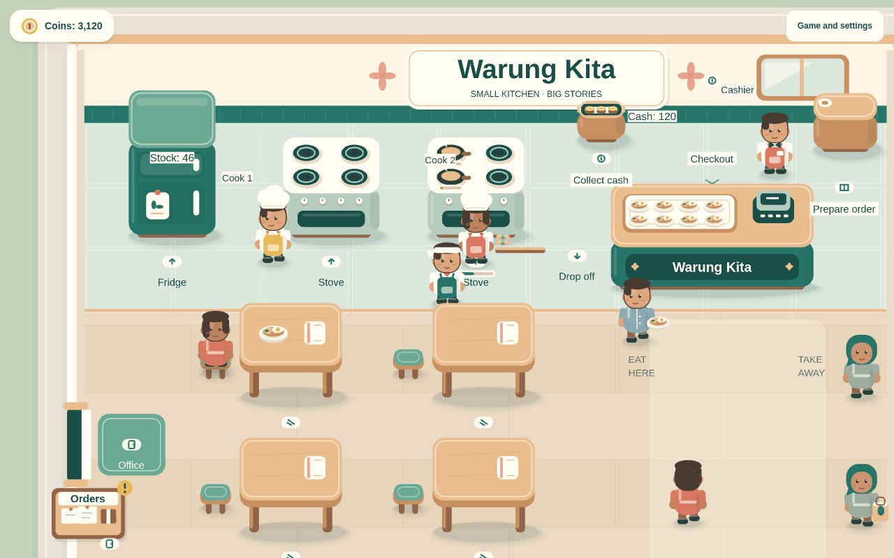
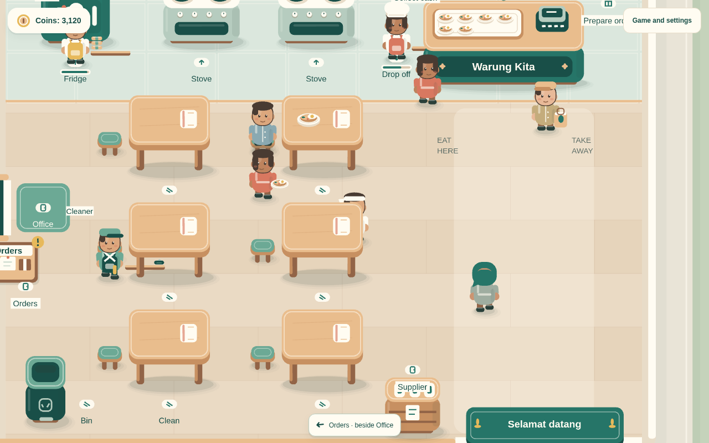
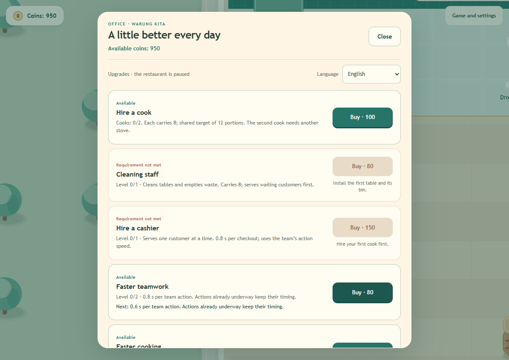
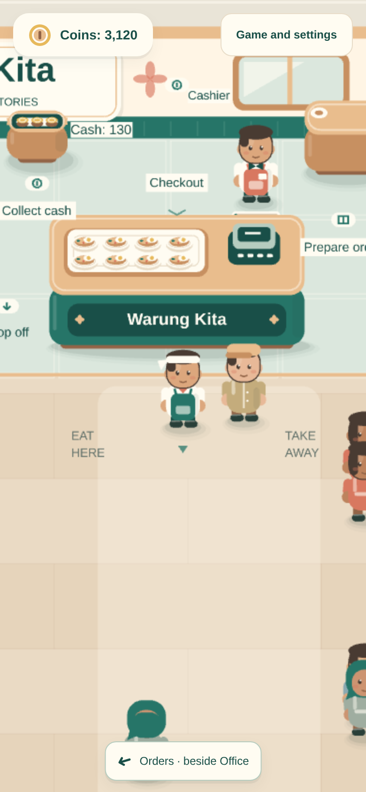

# Warung Kita

> **Work in progress: early playable prototype.**
> 🇪🇸 [Versión en español](README.es.md) · Previous published game: [Nusa: Warung Sort](https://kokeskill.itch.io/nusa-warung-sort) ([source](https://github.com/AlvaroMillanEstevez/nusa-sorting))

Warung Kita ("our warung") is a browser management game about reopening and growing a small Indonesian street restaurant (a *warung*). You walk around the restaurant, cook nasi goreng, serve customers, buy supplies, then reinvest in tables, staff and upgrades until the place runs largely on its own.

It is aimed at casual players who enjoy short cooking and management games. It runs in the browser on desktop and mobile, and has keyboard and touch controls. It is my second Phaser game and a more ambitious follow-up to my puzzle game Nusa: Warung Sort. It is not finished, not deployed anywhere yet, and all art is placeholder art drawn in code.



| Dining room and cleaning staff | Office upgrades (English UI) | Mobile view |
| --- | --- | --- |
|  |  |  |

*Screenshots were taken from the local development build. The gameplay shots use the advanced dev scenario so that the whole team is visible.*

## Gameplay

You start with **150 coins** and a closed, run-down warung. A contextual objective walks you through repairing it, installing a fridge, a stove and a counter, and opening for your first take-away sale. Your progress is saved locally in the browser.

The core loop:

**Supplier → fridge → stove → drop-off counter → checkout → collect cash → restock.**

- **Stay still on an action spot** to work. Each cycle moves one unit (an ingredient, a dish or a customer served) and repeats automatically while there is valid work. Any movement input cancels it.
- **Physical economy:** ingredients are bought from a supplier, either in cash or on credit (a debt repaid from later sales). Sales leave cash in a tray behind the counter that you have to collect.
- **Growing the restaurant:** after your first collected sale you can build an **office** (upgrades panel). From there you add up to six tables, a second stove, two cooks, a cleaner and a cashier, plus action and cooking speed upgrades.
- **Bulk orders:** after hiring the first cook you can build an order board. Optional orders of 4/6/9 portions pay a 50 % bonus if you pack them within 90 s.
- **Demand grows with investment:** customers arrive more often as you spend more on the restaurant (four tiers). The split is 65 % eat-in and 35 % take-away once tables exist.
- **Languages:** Spanish, English and Indonesian, switchable at runtime.

## What works today

- The full loop for one restaurant with one recipe (nasi goreng): guided opening, cooking with four slots per stove, checkout, tables and cleaning, customer queues.
- Staff AI. Cooks batch their work towards a shared 12-portion target and reserve resources so they never take the same item. There is also a cleaner and a cashier who shares the checkout with the player.
- Supplier with cash or credit, debt repayment from sales, a cash tray and a large supply pack unlocked by investment.
- Office upgrades, buildable tables and a buildable order board, construction confirmations, and investment-based demand tiers.
- Local save (format v2) with automatic migration from v1. The dev and normal saves are separate.
- Keyboard (WASD/arrows) and relative touch-drag controls, a camera that follows the player, and a responsive HUD.
- Localization into es/en/id with 276 keys per catalog and a key-parity test.
- 124 automated rule tests (`node:test`), strict TypeScript and a production build.

## What is missing

- Manual review of the latest milestone (normal progression), and balance tuning by real playtesters.
- Testing on physical phones and in browsers other than Chromium/Edge. Mobile has only been checked in device emulation.
- More content: only one location and one recipe so far, no rush hours, no layout editing, and no audio.
- No end goal or long-term progression after the first restaurant is complete. This is the main open design question; see the [roadmap](ROADMAP.md).
- Final art. Everything is drawn procedurally with Phaser Graphics.
- No public build or deployment yet, and no CI.

The planned work, with estimates, is in **[ROADMAP.md](ROADMAP.md)**.

## Tech stack

- [Phaser](https://phaser.io/) 4.2.1 (rendering, scenes, input)
- TypeScript 7 in strict mode
- [Vite](https://vite.dev/) 8 (dev server and bundling)
- npm with a committed `package-lock.json`
- Node's built-in test runner (`node:test`) for rule tests

There is no backend, no external service and no UI framework. There are no downloaded assets either: graphics are drawn in code and the UI uses system fonts. No environment variables are required.

## Requirements

- Node.js **>= 22.18**
- npm **>= 10**

## Install and run

```bash
npm ci
npm run dev
```

Then open <http://127.0.0.1:5173/>. The dev server listens on all interfaces on port 5173. Under WSL it uses file polling, so edits made from Windows are picked up.

| Command | What it does |
| --- | --- |
| `npm run dev` | Start the Vite dev server |
| `npm test` | Run the rule tests (simulation, transfers, navigation, controls, localization, save) |
| `npm run typecheck` | Type-check with `tsc --noEmit` |
| `npm run build` | Type-check and create a production build in `dist/` |
| `npm run preview` | Serve the production build on port 4173 |

### Development helpers (dev server on localhost only)

- `?escenario=avanzado` opens a separate **advanced scenario**. It starts with two tables and all installations already built, and uses its own save slot.
- `?monedas=N` (an integer from 0 to 100000) sets the starting coins of that advanced scenario, for example `?monedas=2000` to try the full team. It does not count as investment and is not saved.
- **F2**, or holding the coin counter for 1.2 s, opens the DEV panel with a reset button.

Production builds ignore all of these.

## Controls

- **Keyboard:** WASD or arrow keys. Diagonals are normalized.
- **Touch or mouse:** drag from any free spot on the canvas. Movement is relative to where you pressed, with no inertia.
- Stand still on a marked spot to act. Panels (office, supplier, order board) open after 1.5 s and pause the game. After closing one, step off the spot before you can reopen it.

## Project structure

```text
src/
  config.ts        Balance values, prices and controls (single source of truth)
  simulation/      Game rules, independent of Phaser and the DOM
                   (Restaurant, Production, Staff, Economy, BulkOrders, Opening, ...)
  world/           Layout, collisions, navigation, camera, stations
  entities/        Player, customers, employees, cargo stacks, input
  scenes/          The Phaser scene that wires simulation and views together
  ui/              DOM panels (office, supplier, orders, session, debug)
  visuals/         Theme tokens and procedural character art
  i18n/            Translation core and es/en/id catalogs
  persistence/     Versioned local save and migration
tests/             node:test rule tests
docs/              Design, economy, progression, localization and verification notes (Spanish)
```

The game rules in `src/simulation/` do not import Phaser. Views only read their state, which keeps the rules testable in plain Node.

## How AI was used

This project was built with an AI coding agent, and I want to be clear about the split:

- **My part:** the game idea, the mechanics and their rules, the economy and balance values, the progression, the visual direction, and the insights on how each system should feel and work. I wrote the specification for each milestone. The agent instructions in [AGENTS.md](AGENTS.md) and the design notes in [docs/](docs/) record these decisions. I reviewed every milestone by playing it myself before approving it. Several were sent back with corrections, as the history in [docs/ROADMAP.md](docs/ROADMAP.md) shows. I also made small manual edits.
- **The AI's part:** almost all of the code, the tests and the first drafts of the documentation were written by **OpenAI Codex** from those specifications. Codex also wrote and ran headless browser QA scripts (not committed) to check flows on desktop and emulated mobile. No AI image generation was used: all graphics are procedural Phaser drawing code. This English README and the roadmap were drafted with **Claude Code** (Anthropic) from the Spanish README and then reviewed by me.
- **Validation:** for every change, `npm test`, `npm run typecheck` and `npm run build`, followed by my own manual playtest of the milestone on desktop and in mobile emulation.

## License

[MIT](LICENSE) © 2026 Álvaro Millán Estévez
